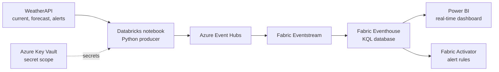

# Real-Time Weather Streaming Pipeline on Azure

A hands-on data engineering project that pulls weather data from a REST API, publishes it to Azure Event Hubs, and analyses it in near real time with Microsoft Fabric.

I built it to move from batch ETL into cloud and streaming data engineering, with a focus on secure secret handling, reliable ingestion and alerting.

## Architecture

| Stage | Technology | Purpose |
|---|---|---|
| Source | WeatherAPI (REST) | Current weather, air quality, 3-day forecast and alerts |
| Producer | Azure Databricks notebook (Python) | Calls the API, flattens the JSON, sends events |
| Secrets | Azure Key Vault + Databricks secret scope | Keeps the API key and Event Hubs connection string out of the code |
| Ingestion | Azure Event Hubs | Receives the event stream |
| Streaming | Microsoft Fabric Eventstream | Routes events into the Eventhouse |
| Storage and query | Fabric Eventhouse, KQL | Stores events and supports time-series queries |
| Reporting | Power BI | Real-time dashboard |
| Alerting | Fabric Activator | Triggers when the weather API reports an alert |

## Notebooks

| Notebook | What it does |
|---|---|
| `Library installation.ipynb` | Installs and checks the `azure-eventhub` package |
| `Unity Catalog volume for streaming checkpoints.ipynb` | Creates a Unity Catalog volume and the checkpoint folder used by the stream |
| `weather-streaming-notebook.ipynb` | Main notebook: tests secrets and the Event Hubs connection, calls the API, flattens the data, and sends events in a streaming job |

## How it works

1. **Secrets.** The API key and Event Hubs connection string are read from a Key Vault-backed Databricks secret scope (`dbutils.secrets.get`). Nothing sensitive is stored in the notebook.
2. **Extraction.** Separate functions call the WeatherAPI current, forecast and alerts endpoints, with a shared response handler.
3. **Transformation.** `flatten_data` merges the three nested JSON responses into one record: location, current conditions, air quality, alerts and forecast.
4. **Publishing.** The `azure-eventhub` client sends each record to Event Hubs as JSON.
5. **Streaming job.** A Spark Structured Streaming `rate` source acts as a timer. `foreachBatch` fetches the weather data and sends it, with a throttle so an event is sent at most every 30 seconds. The checkpoint is stored in a Unity Catalog volume.
6. **Analysis and alerting.** Fabric Eventstream routes events from Event Hubs into an Eventhouse. KQL queries parse the JSON, filter and project fields, and extract alerts. Power BI shows the results and Activator fires on weather alerts.

## Setup

1. Create an Azure Event Hubs namespace and an event hub.
2. Create an Azure Key Vault and store two secrets: the Event Hubs connection string and the WeatherAPI key.
3. In Azure Databricks, create a Key Vault-backed secret scope and give the Databricks Access Connector or service principal permission to read secrets (Key Vault RBAC).
4. Run `Library installation.ipynb`, then `Unity Catalog volume for streaming checkpoints.ipynb`.
5. Update the names in the main notebook to match your setup: secret scope, secret keys, event hub name, Unity Catalog name and the city.
6. In Microsoft Fabric, create an Eventstream with your event hub as the source and an Eventhouse as the destination.
7. Build a Power BI report on the Eventhouse and add an Activator rule on the alert field.

> Do not commit real keys, connection strings or screenshots that show them.

## What I learned and troubleshot

- Key Vault RBAC versus access policies, permission propagation, and secret retrieval failures in Databricks.
- Configuring the Access Connector for Azure Databricks and storing streaming checkpoints in a Unity Catalog volume.
- Controlling Azure cost: I found that NAT Gateway and Databricks charges dominated the bill and reduced spend with auto-termination and by removing unused resources.

## Known limitations and next steps

- The `rate` source is a workaround to trigger API calls on a schedule, because the API itself is not a streaming source.
- `trigger(availableNow=True)` processes available data and stops, so it does not give a continuous 30-second loop. A processing-time trigger or a scheduled job would.
- `handle_response` returns an error string on failure, which later code cannot handle. It should raise an exception or return `None` and be checked.
- The API calls use `http` and send the key as a query parameter. They should use `https`.
- A new Event Hubs producer is created for every event. Reusing a single client would be more efficient.
- Managed identity would be more secure than a connection string for Event Hubs.
- The city is hard-coded. It should come from configuration, and the pipeline could cover several cities.
- Add automated data-quality checks (nulls, ranges, schema) with unit tests, run in an Azure DevOps or GitHub Actions pipeline.
- Define the infrastructure as code (Bicep or Terraform).

## Tech stack

Python, Azure Databricks, Spark Structured Streaming, Unity Catalog, Azure Key Vault, Azure Event Hubs, Microsoft Fabric (Eventstream, Eventhouse, Activator), KQL, Power BI.

## Author

Harini Srinivasaraghavan · [LinkedIn] · [email]
